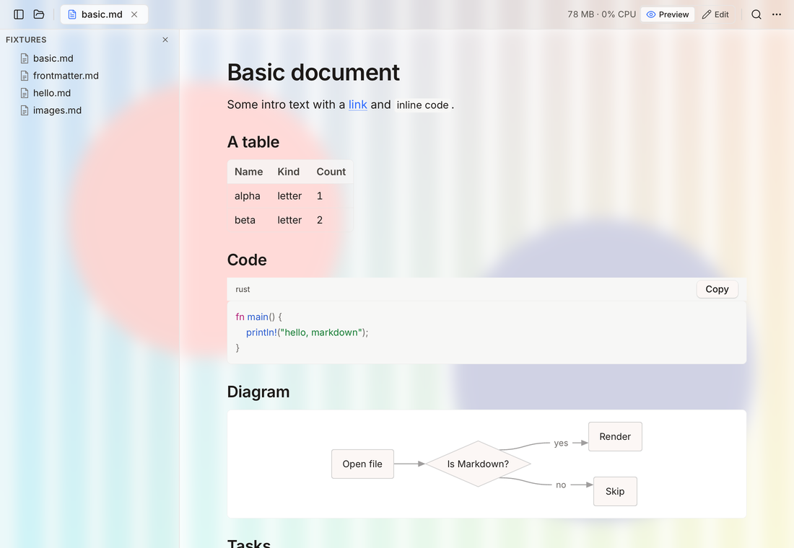
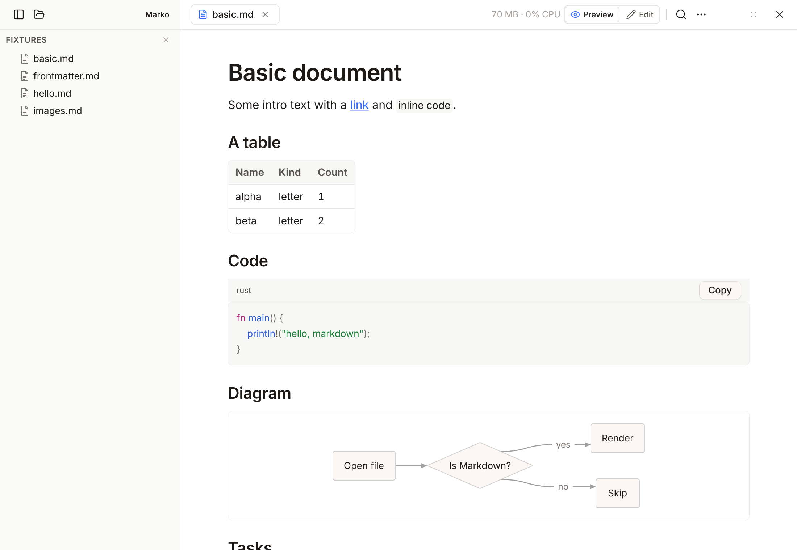
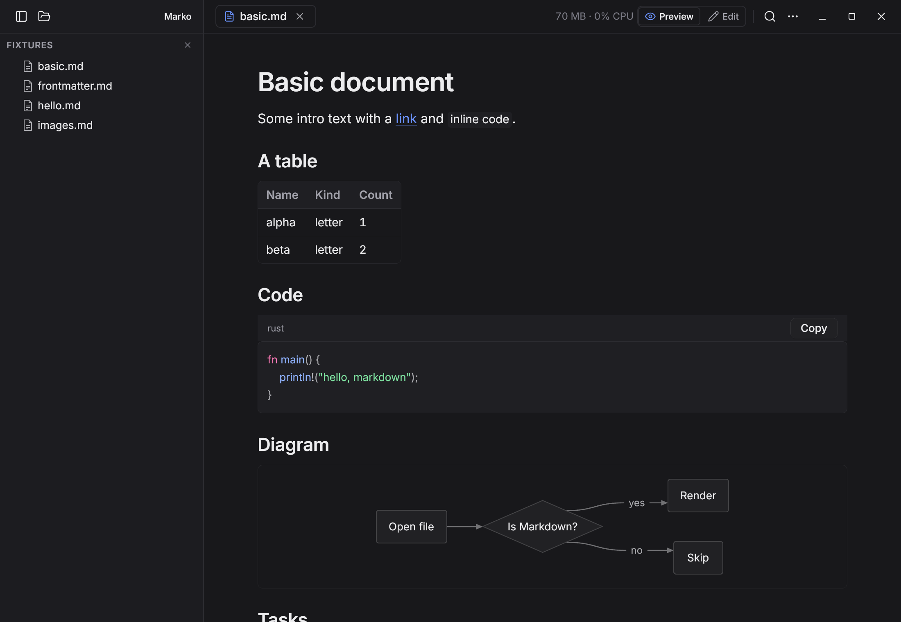
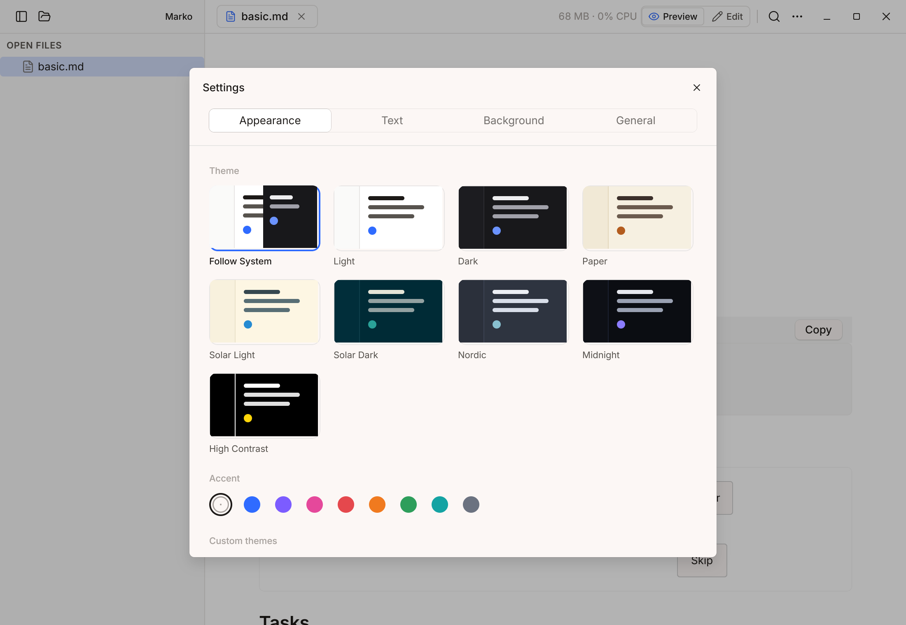
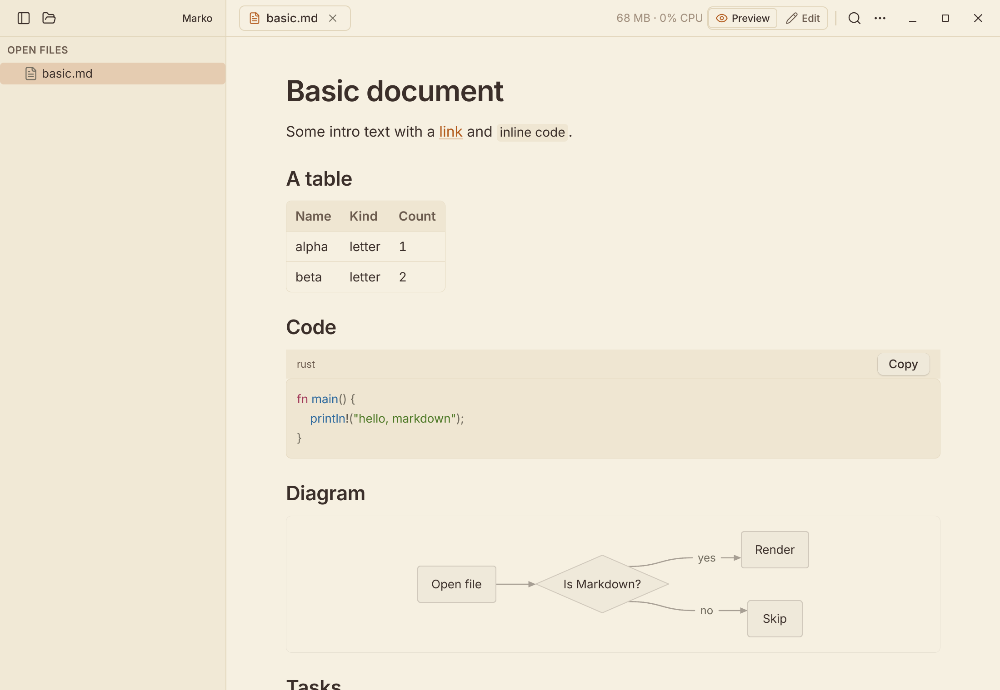
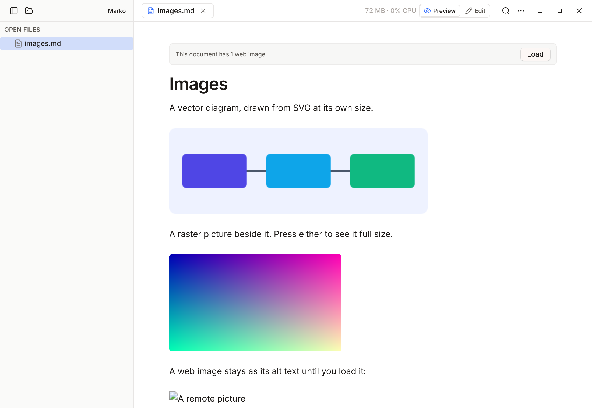
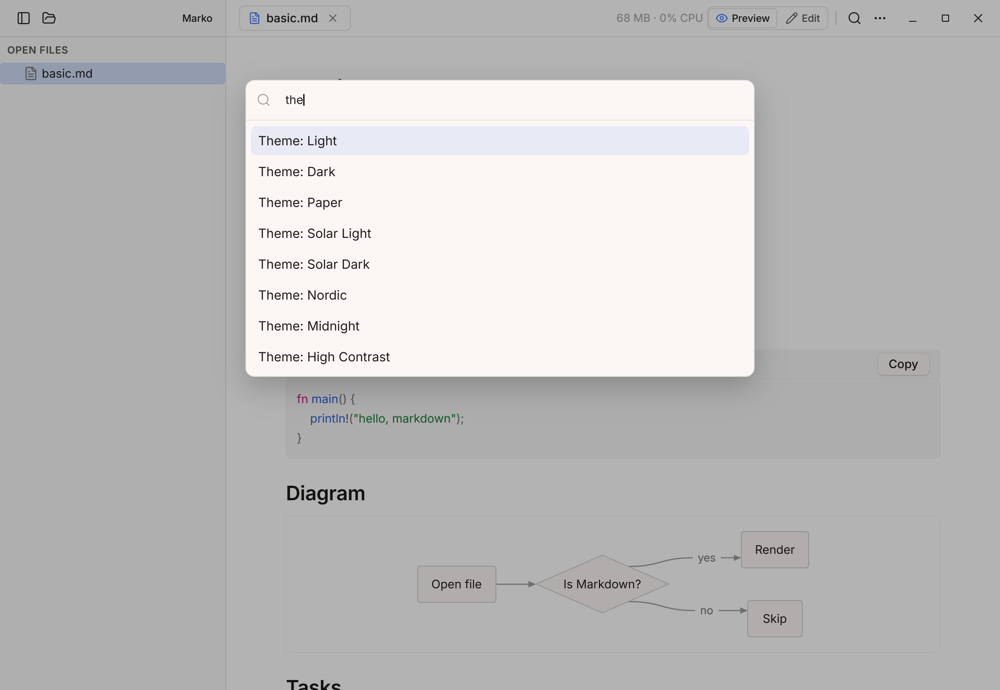

<p align="center">
  
</p>

<h1 align="center">Marko</h1>

<p align="center">A fast, light Markdown viewer and editor for Linux, macOS and Windows.<br>
Native, GPU-drawn, about 65 MB of memory, and nothing running while you read.</p>

<p align="center">
  <a href="https://github.com/been-there-done-that/marko/actions/workflows/ci.yml"></a>
  <a href="https://github.com/been-there-done-that/marko/releases/latest"></a>
  <a href="LICENSE"></a>
</p>

<p align="center">
  
</p>

## Install

**Linux and macOS**

```sh
curl -fsSL https://raw.githubusercontent.com/been-there-done-that/marko/main/install.sh | sh
```

This installs `marko` into `~/.local/bin`. On Linux it also adds a menu entry and icons; on macOS it installs `~/Applications/Marko.app`. No root needed.

**Windows** (PowerShell)

```powershell
irm https://raw.githubusercontent.com/been-there-done-that/marko/main/install.ps1 | iex
```

This installs to `%LOCALAPPDATA%\Programs\Marko`, adds a Start menu entry and puts `marko` on your PATH. To also offer Marko in "Open with" for `.md` files, download `install.ps1` and run `.\install.ps1 -Associate`.

**Options**

| | Linux / macOS | Windows |
|---|---|---|
| A specific version | `sh -s -- --version v0.1.0` | `.\install.ps1 -Version v0.1.0` |
| Build from source | `./install.sh --from-source` (needs Rust) | `cargo build --release` |
| Uninstall | `sh -s -- --uninstall` | `.\install.ps1 -Uninstall` |

Prebuilt downloads for every platform, with a `SHA256SUMS` file, are on the [Releases](https://github.com/been-there-done-that/marko/releases) page.

## Use

```sh
marko notes.md            # open a file
marko README.md docs/     # files open as tabs, folders join the sidebar
```

Or drop files and folders onto the window. Your tabs, folders, scroll positions and window size come back the next time you open it.

The toolbar is the window's title bar. Drag it to move the window and double-click it to maximize or restore, as with any title bar. Minimize, maximize and close sit at its right end on Linux and Windows, and at the left on macOS as usual. On Linux the window edges resize it too.

<p align="center">
  
  
</p>

| Keys (Ctrl on Linux/Windows, ⌘ on macOS) | |
|---|---|
| Ctrl O / Ctrl Shift O | Open file / folder |
| Ctrl N, Ctrl S, Ctrl Shift S | New, save, save as |
| Ctrl E | Switch between Preview and Edit |
| Ctrl F | Find in the document |
| Ctrl Shift P (or Ctrl K) | Command palette: every action, theme and recent file |
| Ctrl , | Settings |
| Ctrl + / Ctrl − / Ctrl 0 | Zoom |
| Ctrl B | Show or hide the sidebar |
| Ctrl R | Reload the file from disk |
| Ctrl Tab, Ctrl 1–9 | Next tab, go to tab |
| Ctrl W, Ctrl Shift T | Close tab, reopen the last closed tab |
| Ctrl Shift PageUp / PageDown | Move the tab left / right |

## Make it yours

Open **Settings** with Ctrl , :

- **Appearance**: eight themes (Light, Dark, Paper, Solar Light, Solar Dark, Nordic, Midnight, High Contrast) or *Follow System*, and an accent colour.
- **Text**: any installed font for reading and for code, ligatures for code fonts that have them, text size, line spacing and a wide reading column, with a live preview.
- **Background**: one picture behind the whole window, with picture opacity, panel opacity, frosted-glass blur, and Cover or Contain.
- **General**: whether web images load on their own, the reading-progress bar, what opens at launch, and the memory and CPU readout.

Settings are shared: change them in one window and every open Marko window follows.

<p align="center">
  
  
</p>

### Your own themes

Settings → Appearance → **Open Themes Folder**, then save a `.json` file there. It appears in the theme list straight away and updates live as you edit it. Copy this and change the colours:

```json
{
  "name": "My Theme",
  "dark": true,
  "bg": "#1E1E2E", "fg": "#CDD6F4", "fg2": "#A6ADC8", "fg3": "#7F849C",
  "accent": "#CBA6F7",
  "bar": "#181825", "side": "#181825",
  "line": "#313244", "line_strong": "#45475A",
  "code_bg": "#181825", "code_line": "#313244",
  "syntax": { "keyword": "#CBA6F7", "string": "#A6E3A1", "function": "#89B4FA",
              "number": "#FAB387", "comment": "#6C7086", "type": "#F9E2AF" }
}
```

The themes folder is `~/.config/dev.marko.app/themes` on Linux, `~/Library/Application Support/dev.marko.app/themes` on macOS, and `%APPDATA%\dev.marko.app\themes` on Windows.

## What it renders

CommonMark with GitHub tables, task lists and strikethrough, plus front matter hidden from view, code with syntax highlighting and a Copy button, Mermaid diagrams, and images (PNG, JPEG, GIF, WebP and SVG). Click any image to see it full size.

Images from the web don't load until you press **Load** on the bar at the top of the document, because fetching one tells its server you opened the file. To load them automatically, set Settings → General → Web images → Always.

<p align="center">
  
  
</p>

## Edit

Press **Edit** (or Ctrl E) for the source beside a live preview that scrolls with it. Saves are atomic. If the file changes on disk while you have unsaved edits, Marko says so instead of overwriting either version. Files you only read reload by themselves when they change.

## Build

Marko is written in Rust on the [Rune](https://github.com/anomalyco/rune) GPU UI framework. For now it builds against [a fork](https://github.com/been-there-done-that/rune/tree/linux-csd-titlebar) that draws the window's title bar buttons and resize edges on Linux ([anomalyco/rune#591](https://github.com/anomalyco/rune/issues/591)); it moves back to upstream Rune once that lands.

```sh
cargo run --release -- README.md
cargo test
```

On Linux you need `pkg-config`, `libfontconfig1-dev`, `libxkbcommon-dev` and `libwayland-dev`.

To rebuild the icons after editing `packaging/icons/marko.svg`:

```sh
rsvg-convert -w 1024 -h 1024 packaging/icons/marko.svg -o marko-master.png
python3 packaging/icons/make-icons.py marko-master.png
```

## Releases

Releases are automatic. To ship a new version, bump `version` in `Cargo.toml` and push to `main`. When CI passes and that version has no release yet, the [release workflow](.github/workflows/release.yml):

1. builds Linux (x86_64, aarch64), macOS (Apple silicon, Intel) and Windows;
2. tags the commit `v<version>` and publishes the archives and `SHA256SUMS` as a GitHub release;
3. installs that release on fresh Linux, macOS and Windows machines with the one-liners above, and checks that the installed `marko` starts and the downloads match their checksums.

Pushes that keep the version don't build anything. Run the workflow by hand from the Actions tab to build every platform without publishing.

## Known limits

- Text inside SVG images is not drawn yet (shapes are).
- The font pickers list installed fonts on Linux; on macOS and Windows they offer the defaults for now.
- On Linux the window has no system shadow or border: Marko draws its own title bar there, and the desktop adds neither.
- macOS builds are signed ad hoc, not notarised. The install script clears the download quarantine for you; if you download the archive yourself, right-click Marko.app and choose Open the first time.

## Contributing

Pull requests are welcome. [CONTRIBUTING.md](CONTRIBUTING.md) covers building, testing, headless screenshots and how commits are written. Bugs and ideas go in [Issues](https://github.com/been-there-done-that/marko/issues).

## License

[MIT](LICENSE)
