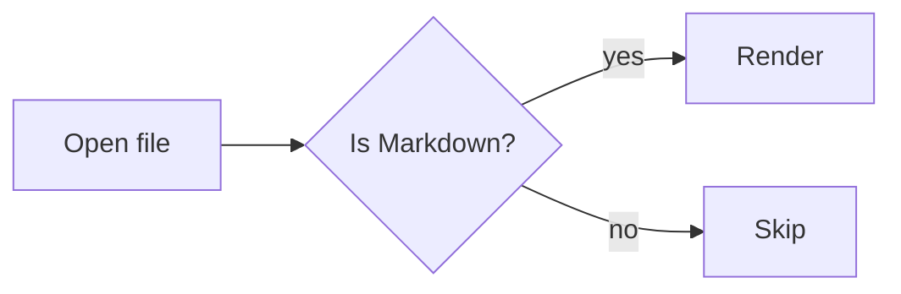

# Basic document

Some intro text with a [link](https://example.com) and `inline code`.

## A table

| Name  | Kind     | Count |
|-------|----------|-------|
| alpha | letter   | 1     |
| beta  | letter   | 2     |

## Code

```rust
fn main() {
    println!("hello, markdown");
}
```

## Diagram



## Tasks

- [x] Read the spec
- [ ] Ship the shell
